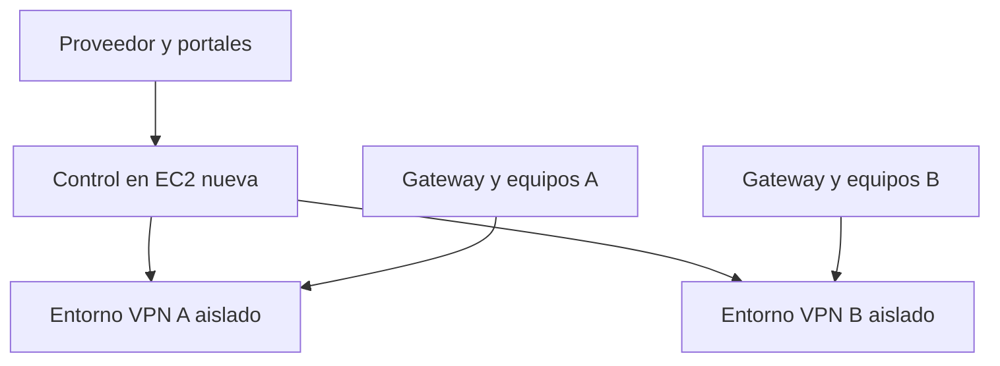

# Proyecto Nexo — contexto para agentes de IA

**Versión del contexto:** 1.1 · 6 de noviembre de 2026
**Fuente principal:** `Analisis_Tecnico_Proyecto_Nexo.docx`, versión 1.2, 20 de octubre de 2026.  
**Documento de producto complementario:** `Definicion_de_Producto_Nexo.docx`.  
**Estado:** alcance comercial v1 y piloto definidos; producción y uso de datos reales siguen sujetos a gates. El contenido no acredita funcionalidad implementada.

## Cómo usar este archivo

Este archivo es el punto de entrada para tareas de análisis, diseño, código, pruebas y documentación de Nexo. Antes de cambiar la arquitectura o afirmar un comportamiento como implementado, consulta el análisis técnico vigente y el código real, si existe. Si discrepan, identifica la diferencia y pide una decisión de producto cuando haga falta. No inventes versiones, costos, capacidades probadas, métricas de rendimiento ni compromisos de servicio.

Al responder sobre Nexo, separa explícitamente: **hechos actuales**, **diseño aprobado como base del piloto**, **opciones por validar**, **evolución futura** y **decisiones pendientes**. Una recomendación técnica nueva debe quedar etiquetada como propuesta, con sus implicaciones para aislamiento, operación, costos y migración.

## 1. Identidad y objetivo

Nexo es un producto SaaS multiempresa para ofrecer conectividad privada y administración de equipos a empresas independientes. La marca comercial final no está decidida. El proveedor administra infraestructura y contratos; cada empresa administra sus usuarios, sucursales y equipos dentro de permisos delegados. La v1 usa un cliente VPN existente aprobado; el cliente universal propio queda como evolución posterior. Soporte remoto y backup comercial no forman parte de la v1.

El servicio VPN conecta exclusivamente redes y recursos privados autorizados. **No ofrece salida general a Internet.** El dispositivo conserva su ruta predeterminada y su navegación local. La v1 comercializa conectividad VPN; soporte remoto y respaldo de archivos sólo podrán incorporarse después como productos o módulos independientes, sin exigir una VPN activa salvo que su diseño futuro lo requiera expresamente.

## 2. Punto de partida comprobado

- El proveedor atiende actualmente a tres empresas independientes desde AWS EC2 con OpenVPN Community sobre UDP, OpenVPN Connect y administración mediante un módulo de Webmin.
- Hay conexiones de sucursales completas y equipos Windows, macOS, Android e iOS. El inventario técnico, las cantidades exactas, las redes, la carga y la capacidad de la instancia deben levantarse antes de dimensionar Nexo.
- La EC2 actual seguirá prestando el servicio OpenVPN durante el piloto y la migración gradual. Nexo se instalará en **una EC2 nueva**, con dirección y configuración propias.
- No hay evidencia en el análisis de que Nexo, su cliente universal, el portal o los respaldos de clientes ya estén implementados. No presentar propuestas de arquitectura como despliegues terminados.

## 3. Reglas de producto que no deben romperse

1. **Aislamiento empresarial.** Usuarios, datos, secretos, operaciones, redes, motor VPN, auditoría y reportes respetan `tenant_id` y permisos. Identificadores suministrados por el navegador nunca establecen por sí solos el contexto de empresa.
2. **Una identidad de endpoint.** Una instalación por sistema y arquitectura mantiene identidad e historial. Activar otro módulo no exige reinstalación manual ni nuevo registro, aunque una actualización firmada o permisos nativos puedan ser necesarios.
3. **VPN privada.** Se rechazan rutas IPv4 o IPv6 por defecto y agregados que conviertan la VPN en salida a Internet. Los gateways sólo anuncian redes aprobadas y deben tener rutas de retorno o SNAT privado limitado según topología.
4. **Permisos por servicio.** Registrar un equipo no autoriza escritorio remoto. La relación comercial, el rol, el recurso, la modalidad y la autorización de soporte se verifican en servidor y motor, no sólo en la interfaz.
5. **Operación verificable.** Distinguir solicitud aceptada, configuración aplicada y conectividad observada. Las tareas asíncronas son idempotentes, tienen revisión y exponen errores por destino.
6. **Sin promesas no probadas.** Una EC2 compartida no equivale a alta disponibilidad ni a EC2 dedicada por empresa. Una copia completada no equivale a recuperación verificada.
7. **Módulos independientes.** Suspender VPN no cancela por defecto remoto o respaldo si siguen contratados. La baja total y la revocación de identidad siguen reglas propias.
8. **Sin licencias comerciales obligatorias por endpoint como requisito de diseño.** Verificar licencias concretas de todos los componentes antes de distribuir el cliente.

## 4. Oferta y alcance

| Capacidad | Estado de producto | Condición principal |
| --- | --- | --- |
| VPN empresarial | Núcleo inicial | Interconexión privada entre sucursales, gateways y equipos; OpenVPN Community primero y adaptador WireGuard según pruebas. |
| Portal del proveedor | Núcleo inicial | Empresas, suscripciones, nodos, entornos, capacidad, operadores, auditoría y reportes. |
| Portal de empresa | Núcleo inicial | Usuarios, sucursales, equipos, invitaciones, políticas y reportes dentro de su ámbito. |
| Cliente VPN existente | Núcleo inicial | Permite el piloto y la primera migración; cliente y plataformas exactos sujetos a prueba. |
| Cliente universal propio | Evolución posterior | Tauri + servicio Go y protección nativa no bloquean la v1; requieren licencias, firma y mantenimiento aprobados. |
| Soporte remoto | Fuera de v1 | Evaluar después como integración con un servicio independiente; no construir motor propio en v1. |
| Respaldo de archivos | Después de la primera migración | Producto separado del backup operativo del control; no bloquea la v1. |
| Cliente móvil propio | Evolución | Android e iOS/iPadOS para VPN y diagnóstico básico; sin control remoto de pantalla. |
| Conexiones directas y relay | Evolución | Requieren coordinación, descubrimiento y pruebas NAT/CGNAT; no se asumen por usar WireGuard. |
| Imagen de equipos, VM o recuperación instantánea | Fuera de primera etapa | Requieren proyectos e integraciones específicos; no se presentan como capacidades del backup de archivos. |

MeshCentral, RustDesk u otro motor de soporte remoto podrán evaluarse después de v1 como servicio independiente; no existe una selección comercial aprobada. Restic y Kopia siguen siendo candidatos para un futuro producto de respaldo. La API aprobada en F01 es un monolito modular TypeScript con NestJS/Fastify y PostgreSQL; Go/Tauri permanecen en los componentes nativos existentes y en la evolución del cliente propio.

## 5. Arquitectura del piloto

El modelo comercial de aislamiento es híbrido por plan. La oferta base puede usar una EC2 compartida: cada `TenantEnvironment` pertenece a una empresa y a un `Node`, con namespace de red y motor VPN independientes. También se necesitan aislamiento de procesos/archivos, límites de CPU/memoria/disco, firewall, secretos separados y autorización a nivel API. Los namespaces comparten kernel y host; la caída del host afecta a todos los entornos y este riesgo debe informarse. El aislamiento dedicado se cobra aparte; su topología exacta —EC2, VPC o cuenta separada— debe aprobarse y costearse antes de ofrecerlo. Es posible que dos empresas usen la misma LAN privada porque sus dominios de rutas están separados; dos sucursales superpuestas de la **misma** empresa requieren resolución explícita.

En el piloto, la EC2 nueva puede alojar plano de control y datos persistentes en servicios separados, con EBS cifrado y copias externas verificadas. Si se desarrolla después el producto **de respaldos de clientes**, su repositorio permanecerá fuera del nodo VPN; tecnología, ubicación, estructura de buckets, claves, costos y retención siguen abiertos. La copia operativa del control de Nexo es obligatoria y diferente del eventual servicio de backup vendido a clientes.

## 6. Actores y permisos

| Actor | Responsabilidad | Límite |
| --- | --- | --- |
| Propietario del proveedor | Empresas, planes, nodos y operadores | El acceso remoto a clientes exige autorización de soporte vigente. |
| Operador del proveedor | Diagnóstico y soporte asignado | No obtiene acceso general a otras empresas o claves. |
| Administrador de empresa | Usuarios, equipos, redes y delegación | No administra el host ni empresas ajenas. |
| Técnico de empresa | Alta de equipos, políticas delegadas y soporte propio | Sólo recursos y acciones autorizados. |
| Auditor de empresa | Lectura de reportes y eventos | Sin cambios de configuración ni control remoto. |
| Usuario final | Su equipo, conexión y solicitud de ayuda | Sin gestión global. |

Los permisos son por acción y recurso (por ejemplo `endpoint.create`, `network.update`, `support.start`, `report.export`), además de empresa y capacidad contratada. MFA para administradores y técnicos. El acceso del proveedor a una empresa se autoriza por separado, con alcance, modalidad, vigencia y responsable.

## 7. Recorridos obligatorios

### Alta de empresa y VPN por el proveedor

La empresa y su suscripción VPN están activas. El proveedor selecciona empresa, nodo, protocolo, rango y política inicial. La API valida cupo, conflictos, puertos y ausencia de salida a Internet; reserva recursos; el agente crea el entorno aislado y confirma revisión. Una prueba con un endpoint distingue entorno aplicado de conectividad real. Un fallo parcial queda bloqueado y visible.

### Sucursal y gateway

Proveedor o técnico delegado crea sucursal, registra CIDR y redes accesibles, emite invitación con capacidad de gateway e instala el agente en un dispositivo compatible siempre disponible. Se configuran y prueban rutas de retorno en LAN o SNAT privado limitado. Se verifica tráfico autorizado en ambos sentidos. Un gateway representa una LAN y no equivale automáticamente al número de equipos de esa sucursal.

### Alta de equipo por técnico del cliente

El técnico con `endpoint.create`, grupo permitido y cupo genera invitación limitada en duración y usos. El usuario instala el cliente universal, el agente genera identidad y claves locales y se registra en la empresa. Si se exige aprobación, permanece pendiente. Tras aprobar, recibe sólo políticas, redes y módulos autorizados. El técnico valida agente, VPN y acceso a un recurso privado. Token vencido, falta de cupo o empresa incorrecta impiden accesos parciales.

### Sesión de soporte remoto

Un técnico autorizado escoge equipo y modalidad. La API verifica contrato, empresa, rol, alcance y permiso. La sesión asistida requiere aceptación local; la desatendida requiere una política previa habilitada por la empresa. Token de sesión temporal con permisos diferenciados para pantalla, terminal, archivos y portapapeles. Se registran participantes, inicio, fin y resultado; revocar acceso cierra la sesión. No prometer cifrado extremo a extremo en todos los transportes sin prueba.

### Respaldo y restauración opcionales

La empresa contrata respaldo y asigna política de carpetas, horario, retención y cuota a endpoints permitidos. El módulo se activa en la instalación existente. El equipo envía archivos al repositorio autorizado mediante su conexión disponible, sin exigir VPN. Cada empresa tiene repositorio y claves separados. Un usuario autorizado elige versión y destino de restauración; el sistema verifica contenido y metadatos. Las copias abiertas, bases de datos, imagen completa, VM e inmutabilidad tienen condiciones técnicas distintas; no inferirlas del respaldo de archivos.

## 8. Estados y reglas comerciales

La suscripción puede estar pendiente, activa, en gracia, suspendida o cancelada. VPN, remoto y respaldo tienen capacidades, cuotas y estado por separado, aunque remoto y respaldo no se comercializan en v1. La primera versión puede registrar pagos manuales; una pasarela de pago específica no es alcance inicial. El techo inicial aprobado de AWS es USD 100 mensuales y el precio parte de USD 45 por empresa, variable por sucursales; aislamiento dedicado se cobra aparte. La fórmula por sucursal y por endpoint móvil sigue pendiente. Cupos de endpoints, redes, técnicos, sesiones y almacenamiento se validan atómicamente. Una reducción de plan muestra exceso y requiere regla explícita; no borra equipos arbitrariamente.

Al cancelar, se ofrece una exportación utilizable —inicialmente ZIP con formatos documentados—, se retienen los datos operativos durante 30 días y después se eliminan de forma verificable. La exportación y eliminación dejan evidencia auditable. El esquema exacto de exportación, tratamiento de copias y plazo de conservación de auditoría deben cerrarse antes de datos reales; no exportar secretos activos o claves privadas sin un mecanismo seguro específico.

Los endpoints pasan por invitado, pendiente, activo, suspendido y retirado. Cada módulo indica por separado si está disponible, habilitado y operativo. La UI no debe confundir esos estados. Retirar un endpoint revoca credenciales y asignaciones activas y retiene historial según política. Reinstalar un equipo exige recuperación explícita o nueva identidad; evitar clones con claves repetidas.

## 9. Contratos y persistencia propuestos

Entidades conceptuales: `Tenant`, `Membership`, `Plan`, `Subscription`, `Site`, `Network`, `Endpoint`, `Enrollment`, `Credential`, `Tunnel`, `Policy`, `Assignment`, `Node`, `TenantEnvironment`, `Operation`, `AgentAck`, `SupportSession`, `UsageSample`, `AuditEvent`. Las relaciones de cliente conservan `tenant_id`; la integridad entre empresas se verifica en la base y en la aplicación. Claves privadas no se guardan como texto en inventario ni en logs.

API de referencia, **aún no implementada ni contractual**: `POST /v1/enrollments`, `POST /v1/agent/enroll`, `POST /v1/tenant-environments`, `POST /v1/support/sessions`, `POST /v1/endpoints/{id}/actions`, `PUT /v1/endpoints/{id}/capabilities`, `GET /v1/operations/{id}`, `POST /v1/agent/telemetry`, `GET /v1/reports/usage`. Versionar esquema antes de implementar. Cambios de configuración usan outbox transaccional, operaciones idempotentes, revisión y confirmación del agente. Nunca aceptar shell arbitrario desde el panel.

## 10. Entrega y validación

Secuencia aprobada: descubrimiento e inventario → prueba técnica en EC2 nueva con empresas ficticias → producto inicial de portal/suscripciones/operaciones → piloto controlado con Disamed → migración real y reversión → ampliación de plataformas → evaluación posterior de soporte remoto y respaldo. No asignar fechas o SLA sin estimación y evidencia.

El caso piloto de Disamed son vendedores móviles sin sucursales que usan laptop, tablet o smartphone para acceder a recursos privados autorizados. El vertical slice debe cubrir invitación/configuración, conexión, acceso sólo al recurso permitido, auditoría, revocación y reversión al OpenVPN anterior. Las plataformas objetivo no equivalen a compatibilidad ya probada; la primera plataforma, cantidades y recurso se fijan con el inventario.

Criterios críticos del piloto:

- Dos empresas con la misma LAN privada no se alcanzan entre sí, incluso manipulando IDs en API, exportaciones, reportes o el motor de soporte.
- Un endpoint y un gateway sólo acceden a recursos privados autorizados. Internet permanece local en IPv4 e IPv6.
- Reinicio de un entorno no afecta a los otros; reinicio completo reconstruye con política de denegación hasta estar listo; fallos a mitad de provisión no abren accesos ni dejan recursos huérfanos.
- Altas simultáneas no exceden cupo; tokens vencidos o usados se rechazan; suspensiones y revocaciones confirman efecto real.
- El control se puede restaurar desde copia limpia. La migración de un grupo real puede revertirse al OpenVPN anterior sin rutas equivalentes ambiguas.
- Si se habilita backup, restaurar contenido y metadatos desde una instalación limpia; una tarea marcada completada no basta.

Las pruebas PV01 a PV21 del análisis técnico son el registro formal de aceptación. La incorporación de clientes reales exige evidencia de las pruebas aplicables, restauración del control y aceptación informada del riesgo de operar inicialmente en una sola EC2.

## 11. Bloqueos vigentes de v1

La priorización detallada está en `docs/decisions/2026-11-06-priorizacion-bloqueos-v1.md`.

- **P0 AWS:** base sin ledger reconciliado, migraciones/grants incompletos, TLS vencido y drift de Security Groups/Terraform. No ejecutar `terraform apply` ni migraciones persistentes sin inventario, plan y autorización específicos.
- **P0 migración F13:** faltan inventario/importación del servicio anterior, cohorte, cutover y switchback selectivo.
- **P0 notificaciones:** `mail-sink`/sink nulo no sirven para invitaciones o recuperación reales; se necesita un canal operativo probado.
- **Gate PV12:** la recuperación integral del control continúa abierta y bloquea datos reales.
- **F08 condicionado por Disamed:** gateway, retorno/SNAT y split-DNS bloquean sólo si el recurso piloto los requiere; el inventario decide el trayecto mínimo.
- **Diferidos:** F10/transporte remoto, F11/WireGuard y el updater/Authenticode/TPM del cliente propio no bloquean v1.

## 12. Parámetros abiertos que un agente no debe inventar

- Nombre comercial, cuotas, política de gracia, fórmula por sucursal/endpoint móvil y contenido final de cada plan.
- Región, instancia EC2, costos, capacidad real, redes y cantidad de clientes/equipos/gateways.
- Cliente VPN existente y primera plataforma exactos del piloto; integración, firma y empaquetado futuro del cliente propio.
- Motor futuro de soporte remoto y repositorio futuro de backup; ambos están fuera de v1.
- Vigencia de última política cuando se pierde control, objetivos de servicio y esquema de alta disponibilidad.
- Autorizaciones delegadas exactas y condiciones de soporte desatendido.
- Topología y precio del aislamiento dedicado.
- Esquema versionado del ZIP de salida, tratamiento de backups al cancelar y retención de la evidencia de auditoría.

## 13. Instrucción recomendada para agentes

> Trabaja en Proyecto Nexo conforme a este contexto y al análisis técnico v1.2. Antes de implementar, inspecciona el repositorio, identifica decisiones abiertas y no conviertas propuestas en hechos. Conserva aislamiento por empresa, VPN sólo para recursos privados, un cliente e identidad por endpoint, permisos de soporte independientes y respaldos externos opcionales. Entrega cambios verificables con pruebas de aislamiento, provisión, revocación y recuperación según el alcance. Si un requisito necesita una decisión comercial o de infraestructura no definida, enumera opciones y consecuencias sin inventar una elección.
