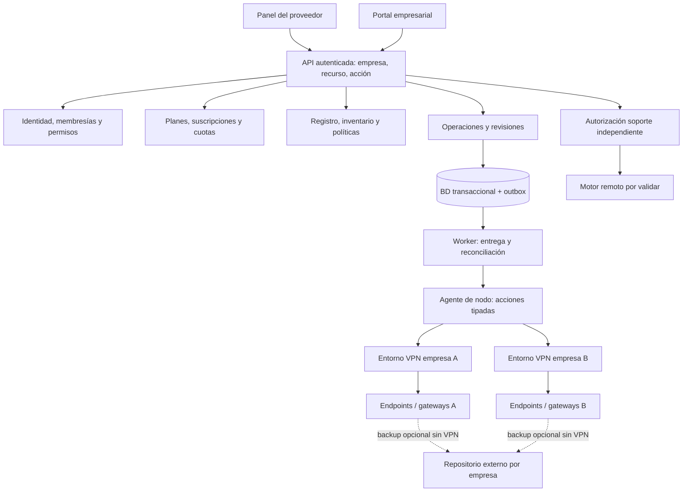

# Arquitectura de referencia y fronteras propuestas

No representa servicios ya implementados. En F01 solo existen los adaptadores del experimento. El stack puede cambiar antes de G01 sin alterar estas invariantes.

## Integración NestJS/Fastify del laboratorio

El candidato TypeScript ya tiene `LabModule`, un controlador con las cuatro operaciones explícitas y un proveedor PostgreSQL detrás del token `LAB_DATABASE`. `application.ts` crea la aplicación con `FastifyAdapter`, configura el parser seguro y sanea errores; `server.ts` habilita el cierre por SIGTERM/SIGINT. El pool se cierra al finalizar el lifecycle de Nest. La dependencia se sustituye únicamente en las pruebas de transporte para comprobar rutas, parser, respuestas y liberación sin una BD; el laboratorio completo conserva PostgreSQL real y las mismas transacciones SQL de los demás candidatos.

No son todavía módulos productivos de identidad, facturación o provisión. No se introdujeron ORM, permisos productivos ni recursos AWS. La validación ejecutada del framework se separa del estado de pruebas PV/UX y de la aceptación formal G01 en `evidence.md`.

## Módulos y contratos

| Módulo | Datos conceptuales de fuente | Frontera y verificación futura |
| --- | --- | --- |
| Identidad | Tenant, Membership | Contexto desde identidad y membresía; acción y recurso, MFA/sesiones en F03 |
| Comercial | Plan, Subscription | Capacidad/estado/cupo por módulo, transacciones concurrentes en F04 |
| Registro | Endpoint, Enrollment, Credential | Token limitado, claves locales, identidad común y recuperación en F07 |
| Redes | Site, Network, Tunnel, Policy, Assignment | Dominio de rutas y permiso por recurso; gateway no modifica router; F08/F11 |
| Infraestructura | Node, TenantEnvironment | Propietario empresarial y nodo proveedor; separación lógica y límites; F05/F06 |
| Operaciones | Operation, AgentAck | Revisión deseada/aplicada y señal observada separadas; outbox y reconciliación F05 |
| Soporte | SupportSession | Autorización adicional en motor, consentimiento y cierre en F10 |
| Observabilidad | UsageSample, AuditEvent | Ámbito empresarial, dedup, fuente, hora y cobertura; F09 |
| Backup opcional | Política, repositorio y restauración por diseñar en F16 | Fuera nodo VPN, claves por empresa y restore verificado; no confundir backup control |

## Persistencia y concurrencia

Las relaciones empresariales usan integridad compuesta por `tenant_id` y recurso o un control equivalente probado. CIDR puede repetirse entre empresas; los solapamientos dentro de un dominio requieren resolución explícita. Estado comercial, registro, disponibilidad del módulo y conectividad no comparten una única bandera `active`.

El cambio de configuración y su evento outbox se confirman en una sola transacción. La ejecución remota se realiza después: no mantener una transacción BD abierta esperando un motor o endpoint. Las operaciones tienen ID, destino, tenant, acción, revisión y expiración; la entrega al menos una vez exige idempotencia. El agente no modifica suscripciones ni emite invitaciones.

## Ubicación del código

Actual: `spikes/api/{typescript,php,go,sql}` es exclusivamente laboratorio. No promover fixtures ni credenciales al producto. La futura estructura de aplicaciones web/API, agentes, cliente nativo, móviles, contratos e infraestructura se decide después de G01; no crear servicios vacíos por cada módulo ni microservicios prematuros.

## Errores, cancelación y compatibilidad

Errores de validación y conflicto no son éxito parcial. Un 202 productivo significa aceptado; el ACK significa configuración aplicada; una prueba independiente demuestra acceso al recurso. Exponer error saneado por destino y reintento seguro. Cancelación/suspensión se representan mediante nuevas operaciones y revisión, no mediante borrado silencioso de historial.

Cambios de esquema compatibles mediante expand-contract. Restaurar el control puede retroceder estado comercial/configuración: debe reconciliar agentes y conservar revocaciones, nunca asumir que la última observación de un nodo otorga permisos. La expiración offline y la política de recuperación se aprueban en su gate.
